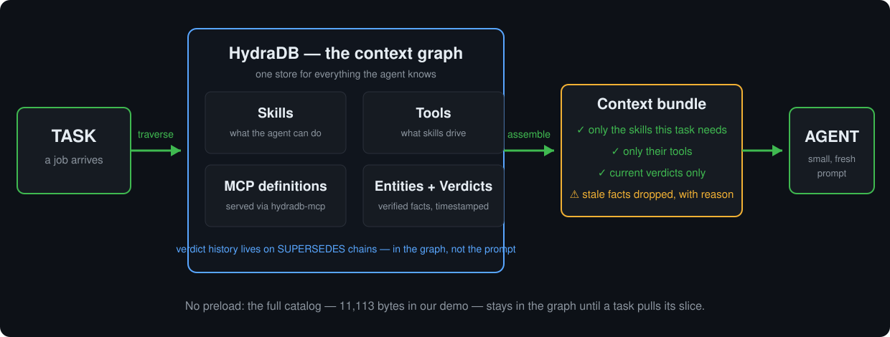

# SkillGraph — the agent context layer on HydraDB

**Pull, don't preload.**

**Evidence, up front**

- **Live demo, running now:** https://skillgraph-gzp1.onrender.com —
  run a task traversal and inspect a verdict chain against the real
  graph in your browser (served by `webapp.py` in this repo)
- Baseline vs improvement, with the Ink Koi learning timeline:
  `RESULTS.md`
- Stock `hydradb-mcp`, unmodified, driven end-to-end over MCP (6-node
  slice — see scope note) — raw exchange: `docs/mcp-exchange.log`
- Consumed by a real LLM run — same question, with vs without the
  bundle; only the with-bundle run can answer it:
  `docs/agent-consumer-transcript.md`
- Verdict time-travel over SUPERSEDES chains — `demo-output.txt`,
  Demo B
- Bundles 255–7,856 B vs 11,113 B full-catalog preload; 200
  traversals, 0 errors — `METRICS.md`

**Pitch.** AI agents drown in their own toolbox: every session starts
by preloading every skill, tool definition and known fact into the
prompt, whether the task needs them or not. That costs tokens on every
run, slows every start, and lets stale facts ride along as if they
were true. SkillGraph stores that working memory in HydraDB as a
graph — skills, tools, MCP servers, entities and timestamped verified
facts (verdicts) — and, given a task, traverses only the subgraph
that task needs and assembles a minimal context bundle. In the
measured demo (33 catalog items, 11,113 bytes serialized), a task's
bundle is 255–7,856 bytes: only the skills, tools and current
verdicts its traversal actually reaches — history and the other ten
skills stay in the graph. Every fact in the bundle is the verdict
currently in force, with its provenance attached, and the history
stays one traversal away instead of cluttering the prompt.

| task type | bundle | vs full preload (11,113 B) | vs current-state preload (10,095 B) |
|---|---|---|---|
| verify_free_mint | 7,856 B | 29.3% saved | 22.2% saved |
| hunt_bounty | 883 B | 92.1% saved | 91.3% saved |
| play_agent_cards | 836 B | 92.5% saved | 91.7% saved |
| build_demo_site | 373 B | 96.6% saved | 96.3% saved |
| backtest_strategy | 255 B | 97.7% saved | 97.5% saved |

Full method and both baselines: `METRICS.md`.

Built for the **HydraDB Hackathon (Nov 14–16, 2026), Track 2 — the
agent context layer**, on the open-source HydraDB server
([hydra-db/hydradb](https://github.com/hydra-db/hydradb)), self-hosted.

## Watch it run (2 minutes)

[**docs/demo.mp4**](docs/demo.mp4) — a narrated walkthrough of the
real runs: a task's traversal, the same traversal over MCP, the
bundle table, and Ink Koi's verdict time-travel. Script:
[`docs/demo-script.md`](docs/demo-script.md). If your player plays
the video muted, the narration is also standalone:
[`docs/demo-narration.mp3`](docs/demo-narration.mp3).

## Architecture



Node classes (carried in a `kind` property; this HydraDB build keys nodes
by integer `id`): `Skill`, `Tool`, `MCPServer`, `Entity`, `Verdict`,
`TaskType`. Edges: `TaskType-[:NEEDS_SKILL]->Skill`,
`Skill-[:USES_TOOL]->Tool`, `Skill-[:ABOUT]->Entity`,
`Entity-[:HAS_VERDICT]->Verdict`, `Verdict-[:SUPERSEDES]->Verdict`,
`Tool-[:EXPOSED_VIA]->MCPServer`. Full model in `schema.md`.

The reference graph is deliberately small — 62 nodes — because it
is one real agent's actual working set, not a synthetic benchmark.
What the demo tests is the *shape*: currency as a chain property,
multi-hop closure, and provenance — properties that do not appear
at any size in a flat file or an embedding index. The same traversal
shapes are also measured on a labeled synthetic graph — 5,000
nodes, 10,000 edges, 8 concurrent clients — in `METRICS.md`
("Scale & concurrency (synthetic)").

Skill→tool and task→skill edges are authored, like any tool
registry or MCP server manifest; verdicts and their SUPERSEDES
chains are written by the verification pipeline, not by hand.

A task becomes a bundle by traversal, not by search:

1. `TaskType → NEEDS_SKILL → Skill` — the capabilities this task needs.
2. `Skill → USES_TOOL → Tool` — only the tools those skills drive.
3. `Skill → ABOUT → Entity`, then for each entity its **current**
   verdict: all `HAS_VERDICT` verdicts minus the ones a newer verdict
   `SUPERSEDES` (this engine has no `NOT EXISTS`, so current-ness is two
   traversals and a set difference — the exact Cypher is in `demo.py`).
4. A staleness guard drops any current verdict older than a configurable
   threshold and says so in the bundle output, so the agent re-verifies
   instead of trusting a stale "fact".

Writes are pipeline-shaped today: the board's autocheck refreshes
entity verdicts, and re-running `seed.py` (idempotent, ≈2 s) lands
them as new verdicts on the SUPERSEDES chain — the store's history
is exactly those refresh cycles. Task-type and skill edges are
registry data, authored like an MCP manifest.

The graph is served two ways, both proven live: the HTTP query API, and
the stock `hydradb-mcp` server over MCP stdio — an MCP client
initialized, listed tools, provisioned a SkillGraph slice through
`execute_query` and ran the same multi-hop traversals back over MCP
(full raw exchange: `docs/mcp-exchange.log`). One honest adaptation: the stock
MCP server scopes queries under `<namespace>/<tenant>/<subtenant>`, so
the MCP-served slice lives in its own tenant scope and is provisioned
through the MCP tool itself; no server code was changed. Scope note: because of that keyspace split, the recorded MCP
exchange runs on a 6-node slice (one task type, skill, tool and
entity, two verdicts) provisioned through `execute_query` itself.
It proves the protocol path and the traversal shapes end-to-end;
the full 62-node graph is served over the HTTP API.

Seed data is real, not lorem ipsum: the agent's actual 12 skill
playbooks, its 7 tools, and 16 NFT-project entities whose verdicts are
the [Mint RedCeh board](https://github.com/Revaaa28/mint-redceh)'s live on-chain checks (2026-11-14). Ink Koi
carries a 3-verdict SUPERSEDES chain from its documented board history
(free pool draining 243 → 135 → exhausted); Floppy Agents carries a
second chain whose older verdicts are explicitly marked MODELED.

The dataset is one real agent's working set, crypto-flavored
because that agent's job is on-chain verification. The schema is
not: swap in a support agent and the same six node kinds hold its
runbooks (skills), its ticketing and CRM tools, its MCP servers,
its customers and services (entities), and the verified facts it
has resolved about them (verdicts — 'their plan renews in March',
with the same supersede-on-correction semantics). Nothing in the
traversal or bundle code mentions mints.

Verdict labels are the board's own: **real** — the free mint checks
out as claimed; **berpotensi** (Indonesian: 'has potential') — real
but in flux, e.g. the free pool is draining; **indikasi**
('indication') — on-chain evidence says the free claim no longer
holds (pool exhausted, sold out, or contradicted).

> **Scope, honestly.** SkillGraph is the store and the pull path. In
> this repo the pull is driven by `demo.py` over HTTP and by an MCP
> client (`mcp_test.py`) through the stock `hydradb-mcp` server.
> The bundle is a plain JSON object shaped to drop into a system
> prompt — and the pull path is demonstrated end-to-end: an MCP
> client pulls it, and a real LLM run consumes it (`agent_consumer.py`:
> asked the same question with and without the bundle, the model
> answers decisively only with it — `docs/agent-consumer-transcript.md`).
> What is not claimed: a full autonomous agent loop — planning,
> acting on the answer and writing new facts back is the next step,
> and this demo doesn't pretend otherwise.

## Why a graph, not a vector store

1. **"Current" is a graph property, not a similarity score.** The right
   verdict for Ink Koi today is `indikasi — free lane CLOSED`; yesterday
   it was `berpotensi — 135 free slots left`. Both texts are near-identical
   embeddings. Only the SUPERSEDES chain knows which one is in force —
   and the demo's time-travel query ("verdict at time T vs now") is a
   chain walk a vector store cannot express at all. (Ink Koi's chain is the board's recorded history — repo:
   github.com/Revaaa28/mint-redceh. The demo's second chain, Floppy
   Agents, is explicitly MODELED and labeled as such in its data;
   it exists to show the chain shape, not as evidence.)
2. **Context assembly is multi-hop by nature.** Task → skills → tools →
   entities → current verdicts is a 4-hop traversal with exact semantics.
   Vector retrieval returns textually similar chunks, not the closure of
   what a task needs — it would happily return the bug-hunting skill for
   a mint-verification task because both mention "verification".
3. **Staleness and provenance are first-class.** Every verdict carries
   `ts` and `provenance` as data on a node, so the assembler can exclude
   facts older than a threshold and cite where each fact came from. In a
   vector store, a stale chunk and a fresh chunk are indistinguishable
   rows of text.

## Who pays, for what

Agent builders and agentic-workflow operators pay for tokens and for
wrong-context failures. SkillGraph is the context service they call
before a run: per-seat/per-call pricing (our working hypothesis) for
hosted traversal + bundle assembly, sold on measured token savings
(22–98% across the five task types in our reference catalog, against
both preload baselines — see `METRICS.md`) and on verdict currency no
embedding index provides. Stale facts are excluded by age at assembly
time, with the reason printed in the bundle. Existing agent-memory layers store and retrieve text; none of
them treat 'which fact is currently in force, and what did it
replace' as a queryable structure. That — not storage — is the
product. The same store doubles as the agent's audit
trail: every verdict in the graph carries its provenance and timestamp
and stays queryable after the fact — something compliance-minded teams
(finance, security tooling) already budget for.

## Run it yourself

You need a running HydraDB node from the open-source server. The real
build sequence (Ubuntu 24.04), including the step the upstream apt
list doesn't mention:

```sh
# 1. System dependencies — upstream's list, which includes the two
#    native libraries the engine links against:
sudo apt-get install -y libcypher-parser-dev libgraphblas-dev
#    …plus the rest of upstream's documented list (build tools,
#    pkg-config, cmake/clang as per the upstream README).

# 2. Rust — the repo's rust-toolchain.toml pins 1.99.0 and rustup
#    honors it automatically inside the repo:
curl --proto '=https' --tlsv1.2 -sSf https://sh.rustup.rs | sh

# 3. Build HydraDB:
git clone https://github.com/hydra-db/hydradb
cd hydradb
#    Ubuntu packages no LAGraph, and the final link fails without it
#    (-llagraph). The repo ships its own installer (LAGraph 1.0.2
#    against GraphBLAS):
bash scripts/install_lagraph.sh "$HOME/lagraph"
LAGRAPH_LIB_DIR="$HOME/lagraph/lib" \
  cargo build --locked --features server-runtime --bin graph-node
#    start graph-node; it serves the HTTP query API on :8443 and writes
#    its bearer token to .hydradb/auth-token

# 4. Point these scripts at your node (token is read at runtime only):
export HYDRA_TOKEN_FILE=/path/to/.hydradb/auth-token
#    …or simply: export HYDRA_TOKEN=<your node token>

# 5. Seed the graph and run the demos:
cd skillgraph
python3 seed.py     # (re)seeds the graph via the HTTP API — idempotent
python3 demo.py     # traversal, bundles, staleness guard, time-travel,
                    # 200-query loopback sanity check; writes metrics.json
HYDRA_MCP_BIN=/path/to/hydradb-mcp python3 mcp_test.py
                    # stock hydradb-mcp over stdio; writes mcp-exchange.log
```

Budget ~15 minutes on a fresh Ubuntu 24.04 box; almost all of it is
the one-time Rust compile. The scripts themselves run in seconds
(seed ≈ 2 s).

`sg.py` is the tiny HTTP client shared by the scripts. Measured numbers
from our reference run: `METRICS.md`; sample output: `demo-output.txt`;
how the reference node was built and probed: `docs/BUILD-LOG.md`.

## Which HydraDB this uses

This entry runs on the open-source HydraDB server from
hydra-db/hydradb — the upstream graph engine and its stock
`hydradb-mcp` server, self-hosted on a single cloud VM. That
choice is deliberate for a context layer: the agent's skills,
tool definitions and resolved facts are exactly the data an
operator most wants on their own infrastructure, and everything
here (Cypher traversals, the MCP tool surface) is the project's
own, unmodified. The hosted cloud was not used; nothing in the
demo depends on it.

It is also a deployment feature, not a workaround: the same official
engine and MCP server, running anywhere — a laptop, a VPS, an
air-gapped box — with no vendor lock-in and the agent's working
memory never leaving the operator's infrastructure.

## Repo layout

```
README.md            this file — pitch, architecture, GTM
METRICS.md           measured results of the reference run
schema.md            node/edge model
sg.py                minimal HydraDB HTTP client (env-based auth)
seed.py              graph seed: skills, tools, task types, entities
scale_gen.py         synthetic scale-test generator — its data is
                     synthetic (ids >= 1,000,000, synth_ names), kept
                     strictly separate from the real demo graph
entities.json        the 16 real board entities (current snapshot;
                     labels are the board's own — real / berpotensi /
                     indikasi, legend in Architecture); the verdict
                     histories live in seed.py
demo.py              demos: traversal, bundles, staleness, time-travel,
                     loopback latency check
demo-output.txt      captured output of the reference demo run
metrics.json         machine-readable metrics from the reference run
mcp_test.py          MCP stdio client driving the stock hydradb-mcp server
agent_consumer.py    the consumer proof: one LLM question asked with
                     vs without the SkillGraph bundle
docs/architecture.svg  the architecture diagram above
docs/agent-consumer-transcript.md  the recorded with/without LLM run
docs/demo.mp4        the 2-minute narrated walkthrough
docs/demo-narration.mp3  the walkthrough's narration, standalone
docs/demo-script.md  the walkthrough's script
docs/mcp-exchange.log  full raw MCP exchange from the reference run
docs/BUILD-LOG.md    build/probe log of the reference deployment
LICENSE              MIT
```

## License

MIT — see `LICENSE`.
